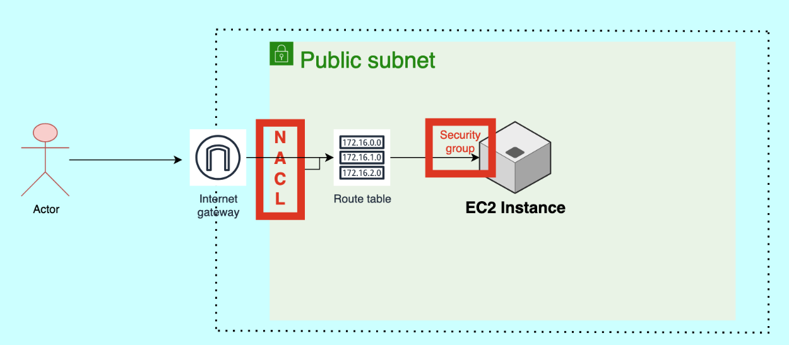
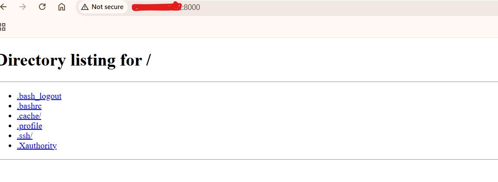

# AWS EC2 Python Application Security Using Security Groups and NACLs

## Project Overview

This hands-on project demonstrates how to host a Python application on an Amazon EC2 instance and control network access using AWS Security Groups and Network Access Control Lists (NACLs).

The infrastructure includes an Amazon VPC with four subnets. The practical test was performed in one public subnet.

## Architecture

The application runs on an EC2 instance and listens on port `8000`. Internet access is controlled by the VPC networking configuration, Security Group rules, and subnet-associated NACL rules.

**Traffic flow:**

Internet → Internet Gateway → Public Subnet → Security Group → EC2 Instance → Python Application (Port 8000)

The NACL filters traffic at the subnet boundary.

## AWS Services Used

- Amazon VPC
- Public subnet
- Amazon EC2
- Internet Gateway
- Route Table
- Security Groups
- Network ACLs (NACLs)
- Python application

## Implementation Steps

### 1. Create the VPC

- Created an Amazon VPC.
- Created four subnets within the VPC.
- Selected one public subnet for the practical test.

### 2. Configure Internet Connectivity

- Used an Internet Gateway for internet connectivity.
- Configured the public subnet's route table to route internet-bound traffic through the Internet Gateway.
- Used an EC2 instance with a public IP address for external access.

### 3. Launch the EC2 Instance

- Launched an EC2 instance in the selected public subnet.
- Set up a Python application on the instance.
- Configured the application to listen on port `8000`.
- python3 -m http.server 8000

The screenshot below records the test server's directory listing. It was started from the home directory; do not use a home directory as a public document root.

### 4. Configure the Security Group

Added an inbound rule for TCP port `8000` to allow access to the Python application.

For better security, restrict the source to your own public IP address whenever possible instead of allowing traffic from anywhere.

### 5. Configure and Test the NACL

- Reviewed the NACL associated with the public subnet.
- Explored inbound and outbound rules.
- Tested how allowing or denying traffic affects connectivity to the application.

NACLs are stateless, so the appropriate inbound and outbound rules must allow the request and response traffic, including applicable ephemeral ports.

## Security Groups vs. NACLs

| Feature | Security Group | NACL |
|---|---|---|
| Applies to | Network interfaces | Subnets |
| Stateful | Yes | No |
| Allow rules | Yes | Yes |
| Explicit deny rules | No | Yes |
| Rule evaluation | All applicable rules | Lowest numbered matching rule |

## Key Learnings

- Hosting a Python application on an EC2 instance.
- Configuring inbound rules for a custom application port.
- Understanding public subnet routing and internet connectivity.
- Comparing instance-level and subnet-level network security.
- Troubleshooting connectivity using Security Groups and NACLs.

## Future Improvements

- Automate the infrastructure with Terraform.
- Add HTTPS using a reverse proxy and TLS certificate.
- Use a load balancer for application access.
- Document successful and blocked connectivity tests.
- Apply least-privilege security rules.

## Security Best Practices

- Avoid exposing SSH (port 22) to the entire internet.
- Restrict application access to trusted IP addresses when possible.
- Never upload AWS credentials, private keys, or sensitive configuration.
- Review and remove unnecessary inbound rules.

## Project Status

Hands-on learning project completed. The practical testing was performed in one public subnet; the remaining subnets were not part of the test.
